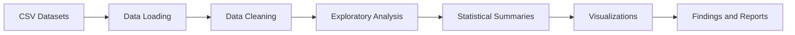

# 📊 Exploratory Data Analysis Portfolio

### Boston Crime Analysis | Walmart Sales Analytics | Netflix Stock Market Analysis

A collection of three data analytics projects exploring public safety trends, retail sales performance, and historical financial market behavior using Python, Pandas, Matplotlib, and Jupyter Notebook.

The projects demonstrate practical skills in **data cleaning, exploratory data analysis (EDA), time-series analysis, statistical summarization, and data visualization**.

<text color="secondary" size="sm">Python · Pandas · Jupyter Notebook · Matplotlib · Data Analytics</text>

---

## Project Highlights

| | Boston Crime | Walmart Sales | Netflix Stock |
|---|---|---|---|
| Dataset size | 353,253 records | 6,435 records | 244 records |
| Domain | Public Safety | Retail Analytics | Financial Analytics |
| Analysis | Crime trends and patterns | Store and weekly sales | Stock returns and volume |
| Data coverage | 2015–2018 | Historical weekly data | Historical daily prices |
| Notebook | `boston_crime_analysis.ipynb` | `walmart_sales_analysis.ipynb` | `netflix_stock_analysis.ipynb` |

## 1. Boston Crime Analysis

<AsyncImageGroup query={["Boston Massachusetts city skyline aerial photography","Boston Massachusetts urban street intersection photography"]} aspectRatio="5:3" layout="carousel"/>

### Objective

Explore historical Boston Police offense records to identify patterns in reported incidents across locations, offense categories, and time periods.

### Analysis Performed

- Combined four annual crime datasets into one analytical dataset.
- Examined offense categories and Uniform Crime Reporting classifications.
- Analyzed reported incidents across streets and locations.
- Explored monthly and seasonal crime patterns.
- Reviewed shooting-related flags while preserving unknown values.

### Dataset

<text color="secondary" size="xs">353,253 offense records · 2015–2018 · Four annual CSV files</text>

The dataset contains offense-level records, so multiple rows may relate to one incident. The 2015 dataset starts mid-year, which limits direct comparisons of raw annual totals.

### Visualization Preview


*Replace the image path above with the actual plot filename generated by the notebook.*

## 2. Walmart Sales Analysis

<AsyncImageGroup query={["large retail supermarket store shelves grocery aisle photography","retail sales business analytics chart dashboard laptop"]} aspectRatio="5:3" layout="carousel"/>

### Objective

Analyze historical weekly Walmart sales records to understand store-level sales performance and identify periods with higher sales activity.

### Analysis Performed

- Examined weekly sales across stores.
- Calculated descriptive sales totals.
- Compared store-level performance.
- Identified store and month combinations with the highest recorded sales.
- Explored sales trends across the available historical periods.

### Dataset

<text color="secondary" size="xs">6,435 store-week observations</text>

The dataset includes incomplete coverage for its first and last years. Annual sales totals are therefore descriptive and should not be treated as normalized year-over-year growth.

### Visualization Preview


*Use the corresponding chart exported from the Walmart notebook.*

## 3. Netflix Stock Market Analysis

<AsyncImageGroup query={["stock market candlestick financial chart on computer screen","financial market trading analysis line graph computer monitor"]} aspectRatio="5:3" layout="carousel"/>

### Objective

Explore historical Netflix stock market data to understand price movements, daily returns, and monthly trading volume.

### Analysis Performed

- Loaded historical stock market data from a supplied CSV.
- Sorted stock records chronologically.
- Calculated daily stock returns.
- Aggregated trading volume by month.
- Visualized historical stock market trends.

### Dataset

<text color="secondary" size="xs">244 historical stock price observations</text>

This project uses a historical snapshot rather than a live market feed. Trading volume represents shares traded, not the number of individual traders.

### Visualization Preview


*Use the corresponding figure exported from the Netflix notebook.*

---

## Technology Stack

| Category | Tools |
|---|---|
| Programming | Python 3.12 |
| Data Analysis | Pandas |
| Visualization | Matplotlib and notebook-generated plots |
| Development | Jupyter Notebook |
| Data Formats | CSV |
| Analysis Techniques | EDA, aggregations, time-series analysis |

## Project Workflow



## Getting Started

### Clone the Repository

```bash
git clone https://github.com/ds2204/Boston-crime-exploratory-analysis.git
cd Boston-crime-exploratory-analysis
```

### Create a Virtual Environment

```bash
python3 -m venv .venv
source .venv/bin/activate
```

### Install Dependencies

```bash
pip install -r requirements.txt
```

### Launch Jupyter Notebook

```bash
jupyter notebook
```

Open any of the three notebooks and select **Run All**.

All three notebooks use locally supplied datasets and do not require live web access.

## Validation

Run the offline validation script:

```bash
python validate_notebooks.py
```

The validation process executes notebook cells sequentially and saves generated plots.

| Validation | Reported status |
|---|---|
| Boston Crime Notebook | Passed |
| Walmart Sales Notebook | Passed |
| Netflix Stock Notebook | Passed |
| Total notebook code cells | 100 executed |
| Local dataset loading | Supported |
| Live web data required | No |

Validation outputs are stored in the ignored `artifacts/` directory. Reproduced plots are stored in `figures/`.

## Data Sources

- **Boston Crime:** Historical Boston Police offense datasets, with source references documented in the supplied project reports.
- **Walmart Sales:** [Walmart Retail Dataset on Kaggle](https://www.kaggle.com/datasets/rutuspatel/walmart-dataset-retail).
- **Netflix Stock:** Historical financial dataset, with its original FinancialContent reference retained in the notebook.

Dataset redistribution rights should be confirmed before public release.

## Documentation

- `AUDIT.md` contains validation findings and file-level review notes.
- `ATTRIBUTION.md` preserves original coursework and contributor attribution.
- Historical PDF and DOCX reports are retained for reference. Some content may differ from the corrected notebooks.

## About This Portfolio

This repository showcases foundational analytical workflows across three different domains:

**Public Safety Analytics** · **Retail Performance Analysis** · **Financial Time-Series Analysis**

The focus is on transforming raw datasets into structured analytical outputs, producing reproducible visualizations, and communicating findings through Python notebooks.

Maintained under [ds2204](https://github.com/ds2204). Original attribution is documented in `ATTRIBUTION.md`.

---

### Licensing

The supplied coursework and datasets did not include complete redistribution permissions. Their applicable licensing terms must be confirmed before public redistribution. No new license is implied for third-party materials.
